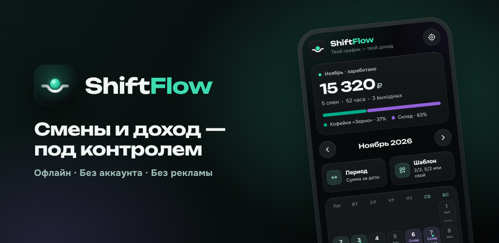

<p align="center"></p>

<h1 align="center">ShiftFlow</h1>
<p align="center">Календарь рабочих смен и учёт дохода. Офлайн, без аккаунта, данные только на устройстве.</p>

<p align="center"></p>

## Что внутри

| Папка | Что это |
|---|---|
| `web/` | Приложение: `index.html` (разметка и стили), `app.js` (логика), шрифты, иконки, `manifest.webmanifest`, `sw.js` (офлайн), `privacy.html`. Это же содержимое заливается на сайт. |
| `android/` | Android-приложение (Java + WebView). При сборке берёт интерфейс из `web/`. Сборка: `cd android && ./gradlew bundleRelease`. |
| `store/` | Всё для магазинов: тексты карточек (RU/EN), скриншоты 1080×1920, баннер 1024×500, значок 512×512 и пошаговая инструкция `store/RELEASE.md`. |
| `tools/brand/` | Логотип как код: `mark.mjs` (геометрия знака) и `build-icons.mjs` (все иконки для веба, Android и магазинов). |
| `tools/store/` | `build-store-assets.js` — снимает скриншоты из настоящего интерфейса на демо-данных и собирает графику для магазинов. |
| `lib/`, `pubspec.yaml` | Старый прототип на Flutter, в сборку не входит. |
| `octostore/` | Отдельный сайт-магазин, к ShiftFlow не относится. |

## Логотип

«День» лежит в изгибе линии потока: шар — активная смена, линия — течение времени. Та же форма
повторяется в нижней панели навигации: выбранная вкладка поднимается в пузырь, а край стеклянной
панели прогибается под ним.

## Возможности

- Календарь смен: смена или выходной в одно касание, свайп — смена месяца, заметки к дням
- До 10 мест работы: цвет, почасовая или фиксированная ставка, валюта, часы по умолчанию
- Корректировки к оплате (чаевые, вычеты), шаблоны графика (2/2, 3/3, 5/2…), подсчёт за любой период
- Финансы: итог месяца по местам работы, статистика за год с графиком по месяцам, выгрузка в Excel
- Оформление: тёмная/светлая/системная тема, 6 цветов акцента, размер текста, стиль скруглений
- Резервная копия в файл и восстановление; русский и английский язык

Данные хранятся в `localStorage` под теми же ключами, что и в прошлых версиях (`tabel-data`, `tabel-prefs`),
поэтому после обновления сайта у пользователей ничего не теряется.

## Как обновить сайт

Залей содержимое папки `web/` на Cloudflare Worker целиком (`index.html` теперь использует `app.js`,
шрифты и иконки рядом с ним).

## Сборка Android и публикация

См. [`store/RELEASE.md`](store/RELEASE.md) — ключ подписи, сборка AAB/APK (локально или в GitHub Actions),
Google Play и RuStore по шагам.

## Перегенерация графики

```bash
node tools/brand/build-icons.mjs          # иконки (веб, Android, магазин)
node tools/store/build-store-assets.js    # скриншоты, баннер, og-image
```
Нужен Playwright с Chromium: `npm i -g playwright && npx playwright install chromium`.

## Лицензия

MIT — см. `LICENSE`. Шрифты Unbounded (заголовки и суммы) и Onest (текст) распространяются по SIL Open Font License (`web/fonts/OFL.txt`).
