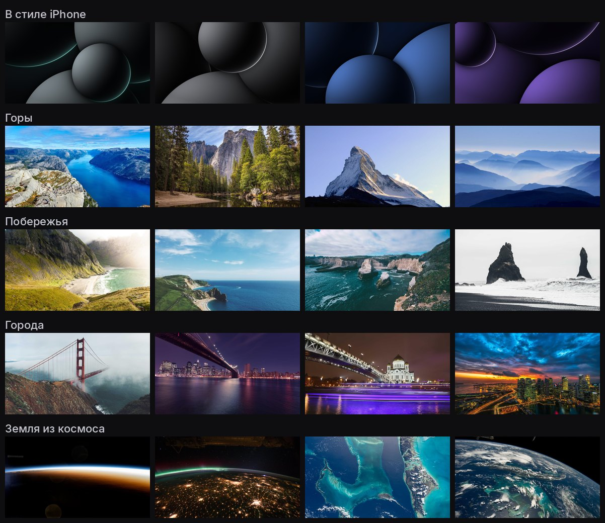
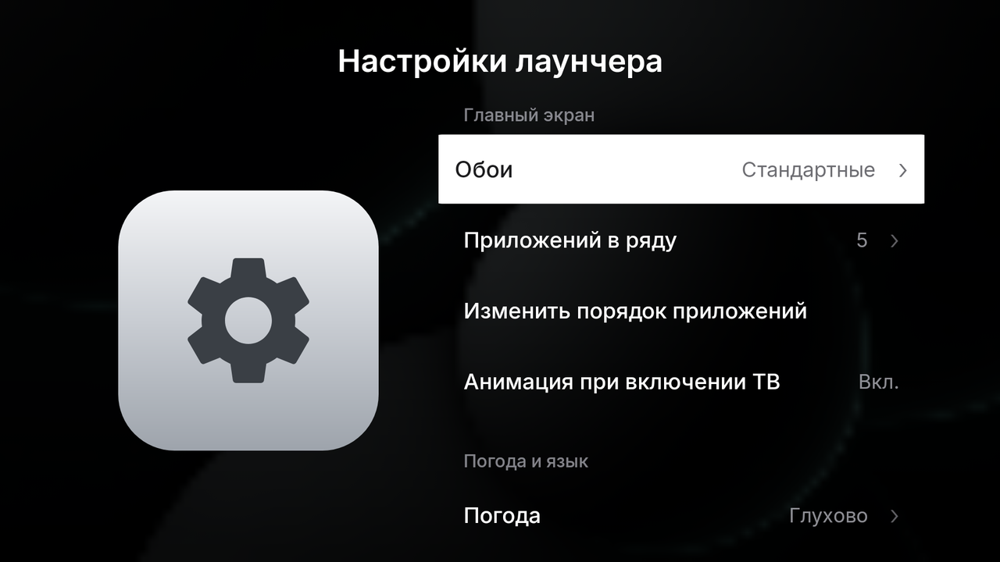
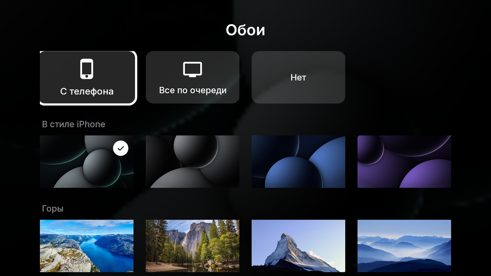
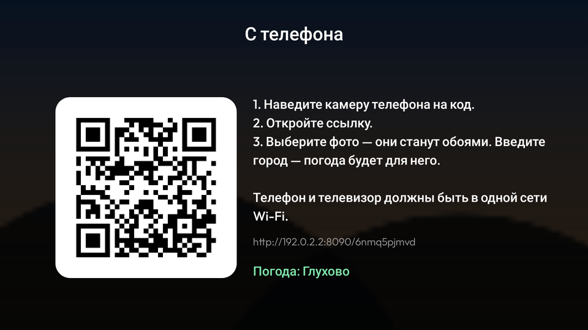
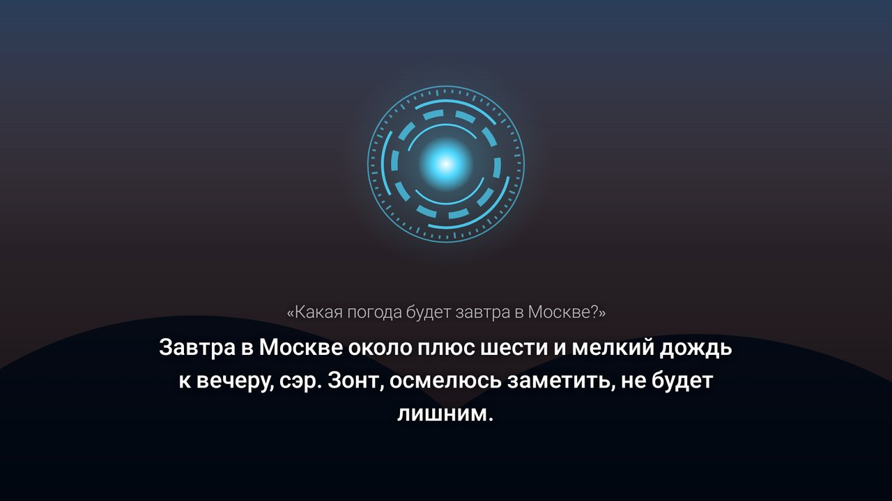

# CleanYourTV на Сбер Салют ТВ — с телефона, без компьютера

[CleanYourTV](https://github.com/Gathin23/cleanyourtv) убирает с Android-телевизора рекламу,
телеметрию и лишние приложения и ставит чистый домашний экран. Обычно его запускают с
компьютера. Здесь всё то же самое делается с **Android-телефона** через Termux.

Для Салют ТВ в CleanYourTV уже есть проверенный профиль:
[`examples/sber-salute-tv-at30a6`](https://github.com/Gathin23/cleanyourtv/tree/b06ab21105c49900cb1ed76b24414dba1e21d0db/examples/sber-salute-tv-at30a6)
(Салют ТВ 43", StarOS 1.101, Android 13, проверен 19–23 октября 2026). Скрипт `sber-tv.sh`
запускает **оригинальные скрипты проекта** с этим профилем. Домашний экран не собирается на
телефоне, а берётся уже собранный APK `tvhome-3.0-sber4.apk`: это лаунчер CleanYourTV из того же
коммита с добавками для Салют ТВ — вид Apple TV с 20 стандартными обоями по категориям, компактные
кнопки сверху, VPN одной кнопкой, погода, плитка «Настройки лаунчера» (обои, в том числе с
телефона по QR-коду, погода, язык, заставка), библиотека приложений плитками, отключение кнопок
Сбера на пульте и голосовой ассистент **Джарвис** вместо ассистента Сбера (исходники правок —
[`launcher/sber.patch`](launcher/sber.patch)). Скрипт проверяет контрольную сумму APK.

> Пакеты только **отключаются** (`pm disable-user`), ничего не удаляется. Всё возвращается
> одной командой `restore`. Root и перепрошивка не нужны.

## Что понадобится

- Android-телефон в той же Wi-Fi-сети, что и телевизор. iPhone не подойдёт: на нём нет Termux.
- [Termux](https://f-droid.org/packages/com.termux/) из F-Droid или с
  [GitHub](https://github.com/termux/termux-app/releases). Версия из Google Play устарела и не работает.
- Около 150 МБ свободного места на телефоне.

Провода, флешка и компьютер не нужны: телефон управляет телевизором по Wi-Fi, а ярлык заводского
меню ставится на ТВ через интернет.

## Шаг 1. Включить ADB на телевизоре

Пункт «Для разработчиков» на Салют ТВ заблокирован: семь нажатий на номер сборки ничего не дают.
Есть два способа включить ADB, оба делаются с телефона и пульта.

**Вариант А: официальный, через SmartApp Studio.** Всё делается в браузере телефона.
1. Откройте [developers.sber.ru](https://developers.sber.ru) и войдите под **тем же Сбер ID**, что и на ТВ.
2. Создайте в личном пространстве пустой проект SmartApp. Без него раздел SmartApp не появится.
3. Откройте Настройки → Настройки сервисов → SmartApp → **Мои устройства**. Добавьте ТВ по
   серийному номеру (на ТВ: Настройки → Об устройстве; регистр важен) и включите **ADB**.
4. Перезагрузите телевизор.

На проверенном телевизоре переключатель включился, но порт 5555 так и остался закрытым.
Проверьте шагом 4 командой `probe`. Если подключиться не получится, используйте вариант Б.

**Вариант Б: заводское меню (FactoryMenu).**
1. Скачайте ярлык `FactoryMenu` (`com.stb.factorymenu` 1.2, 16 КБ) из
   [этого сообщения на 4PDA](https://4pda.to/forum/index.php?showtopic=1042253&view=findpost&p=114157954).
   Для скачивания нужен аккаунт на 4PDA.
2. Поставьте его на ТВ по интернету, через кабинет Сбера
   ([инструкция Сбера](https://sberdevices.ru/help/install-apps/)). Нужны прошивка 1.81 или новее
   и выключенный родительский контроль.
   - На телефоне откройте [apps.sber.ru/my](https://apps.sber.ru/my/) и войдите под тем же Сбер ID,
     что и на ТВ.
   - Нажмите «Прикрепите файл», выберите FactoryMenu из «Загрузок», нажмите «Сохранить» и
     дождитесь проверки на вирусы.
   - На ТВ откройте «Сервисы» → «Мои приложения» → «Загруженные» и нажмите на карточку FactoryMenu.

   Если кабинет не принял файл, остаётся флешка: скопируйте APK на неё через OTG-переходник,
   вставьте в ТВ и установите из файлового менеджера телевизора.
3. Откройте FactoryMenu, перейдите в **Debug** и включите **ADB Enable**.
4. **Больше в этом меню ничего не трогайте.** Там же лежат настройки панели и изображения.
   Другие приложения `com.cvte.*` тоже не открывайте.

## Шаг 2. Узнать IP телевизора

На ТВ: Настройки → Сеть → ваша сеть → IP-адрес, например `192.168.1.50`. Ещё его можно найти
в списке устройств на роутере.

## Шаг 3. Подготовить Termux

Откройте Termux и выполните:

```bash
pkg update && pkg upgrade -y
curl -LO https://raw.githubusercontent.com/dimavotinov73-beep/ShiftFlow/ccr-e16201a1-9rnk6y/sber-tv/sber-tv.sh
```

## Шаг 4. Проверить связь

```bash
bash sber-tv.sh 192.168.1.50 probe
```

При первом запуске скрипт скачает CleanYourTV (около 45 МБ), поставит Python и библиотеку для ADB.
Это займёт несколько минут.

На телевизоре появится вопрос **«Разрешить отладку по USB?»**. Отметьте «Всегда разрешать» и
нажмите OK. Слово «USB» тут ни на что не влияет: подключение идёт по Wi-Fi. После этого в Termux
появятся модель и версия Android телевизора.

## Шаг 5. Почистить телевизор

```bash
bash sber-tv.sh 192.168.1.50
```

Скрипт выполнит четыре шага, как в профиле CleanYourTV:

1. Отключит 25 приложений и сервисов Сбера (полный список с комментариями — в
   [`debloat.txt`](https://github.com/Gathin23/cleanyourtv/blob/b06ab21105c49900cb1ed76b24414dba1e21d0db/examples/sber-salute-tv-at30a6/debloat.txt)):
   Звук, «Видео», SberPlay, СберПрайм, «Детская комната», родительский контроль, «Умный дом»,
   браузер Салют, каталог приложений Сбера, заставку на 220 МБ, опросы, бета-программу, сборщик
   ошибок, приёмники трансляции экрана (Huawei Cast, MHshare, DLNA) и другие.
   Сообщение `Skipping ru.sberdevices.starlauncher: it owns Home` в этом шаге — это нормально:
   старый домашний экран отключит шаг 2.
2. Поставит новый домашний экран и сделает его главным, а старый домашний экран Сбера отключит.
   Если новый экран не запустится, старый останется на месте.
3. Применит настройки из профиля: служебные приложения скрыты, у приложений Сбера русские названия.
4. Включит заставку-часы нового экрана. Если оставить заставку Сбера, StarOS включит её обратно.

Если модель вашего ТВ отличается от проверенной (`at30a6`), скрипт предупредит и спросит,
продолжать ли.

### Что останется работать

- **Голосовой ассистент Салют.** Он встроен в системный сервис Сбера, который нельзя отключить.
  Кнопку ассистента можно отдать другому приложению (например, Алисе) — см.
  [«Кнопки Сбера на пульте»](#кнопки-сбера-на-пульте).
- **HDMI- и AV-входы:** кнопка Inputs на новом экране переключает HDMI1–3 и AV.
- Клавиатура, WebView, настройки, пульт.
- **Обновления прошивки.** Они остаются включёнными, как в профиле по умолчанию.

## Google Play на телевизоре

**Настоящий Google Play на Салют ТВ без root не поставить.** В StarOS нет сервисов Google.
Play Маркету нужны «Сервисы Google Play» и Google Services Framework, и стоять они должны как
системные приложения (`/system/priv-app`). Для этого нужны root и отключённая проверка подписи
в прошивке. На 4PDA для телевизоров на этом шасси так и делают, но только с root. Сертификата
Google у такого ТВ всё равно не будет, и загрузки из Маркета, по отзывам, иногда зависают.
Без root через ADB этого не сделать, поэтому здесь такого способа нет.

**Что работает без root — Aurora Store.** Это открытый клиент Google Play: тот же каталог,
приложения скачиваются с серверов Google, можно войти анонимно, сервисы Google не нужны.
У версии 4.8.4 есть режим для Android TV: она видна в TV-лаунчере и не требует сенсорного экрана.

```bash
bash sber-tv.sh 192.168.1.50 aurora
```

Скрипт скачает Aurora Store с F-Droid и сверит контрольную сумму. Потом поставит Aurora на ТВ и
разрешит ей устанавливать приложения. Aurora появится на новом домашнем экране. При первом
запуске выберите **анонимный вход**.

Ограничения:

- Приложения, которым нужны сервисы Google, не запустятся или будут ругаться. Например,
  официальный YouTube для ТВ пишет, что устройство не поддерживается. Вместо него можно поставить
  [SmartTube](https://github.com/yuliskov/SmartTube/releases) командой `apk`, см. ниже.
- Покупки и подписки через Google Play не работают.
- Если установка приложения в Aurora зависает, поменяйте в настройках Aurora способ установки
  (Installer) на другой.
- Салют ТВ сам удаляет сторонние приложения, когда на диске остаётся меньше ~355 МБ. Если ставите
  много приложений, выполните один раз `bash sber-tv.sh 192.168.1.50 rotation` и перезагрузите ТВ.
- Чистка отключает каталог приложений Сбера. Скорее всего, через него же работает установка из
  кабинета apps.sber.ru/my, поэтому после чистки ставьте приложения через Aurora или командой `apk`.
  Если каталог нужен, включите его обратно:
  `bash sber-tv.sh 192.168.1.50 shell 'pm enable ru.sberdevices.starmarket'`.

### Поставить любой APK с телефона

```bash
termux-setup-storage     # один раз: даёт Termux доступ к «Загрузкам» телефона
bash sber-tv.sh 192.168.1.50 apk ~/storage/downloads/SmartTube.apk
```

Если приложение состоит из нескольких файлов (base.apk и split_*.apk), перечислите через
пробел все файлы одного приложения. Архивы `.apks`/`.xapk` сначала распакуйте:
`pkg install unzip && unzip файл.apks`.
Узнать, какая сборка нужна (armeabi-v7a или arm64-v8a):
`bash sber-tv.sh 192.168.1.50 shell 'getprop ro.product.cpu.abilist'`.

## Вид Apple TV, обои, погода, кнопка VPN

Домашний экран выглядит как у Apple TV, и выбирать стиль больше не нужно: стеклянная полка под
первым рядом, выбранная плитка приподнимается на свечении своего цвета, название — только у
выбранной. Шрифт — Inter, близкий к шрифту Apple, с нормальной кириллицей. Сверху слева время и
дата, справа погода и круглые стеклянные кнопки: **Wi-Fi, VPN, Источники, Настройки**. Кнопка под
выделением раскрывается с подписью. Wi-Fi и VPN **белеют**, когда подключены. OK на кнопке VPN
включает или выключает VPN, **удержание OK** открывает само VPN-приложение.

Обновить домашний экран (порядок приложений и обои с телефона сохранятся):

```bash
bash sber-tv.sh 192.168.1.50 update-launcher
```

**Стандартные обои** — 20 картинок, по 4 в категории: **в стиле iPhone** (глянцевые сферы с тонкой
светящейся кромкой, как обои iPhone 16, но нарисованные для лаунчера, а не обои Apple), **горы**,
**побережья**, **города**, **Земля из космоса** (снимки с МКС). Они встроены в сам лаунчер и появляются
сразу после обновления; на экране — первая, графитовая с бирюзовой кромкой. Остальное — свои фото
с телефона по QR-коду (см. ниже). Обои прошлых тем (рисованные пейзажи и прочее) при обновлении
убираются; фото, присланные с телефона, остаются.



**Анимация при включении ТВ.** Экран проявляется из чёрного, обои медленно приближаются, время и
кнопки опускаются на место, а полка с приложениями поднимается и раскрывается — около полутора
секунд. Играет и когда ТВ выходит из режима ожидания с уже открытым главным экраном, и после
заставки. Выключить — «Настройки лаунчера» → «Анимация при включении ТВ». Анимации **при выключении**
нет и быть не может: кнопку питания система обрабатывает сама и гасит экран раньше, чем любое
приложение успеет что-то нарисовать.

**Погода** сразу показывается для Глухово (Красногорский округ). Берётся с
[Open-Meteo](https://open-meteo.com): без ключей и регистрации, раз в полчаса. Другое место — на ТВ
(«Настройки лаунчера» → «Погода»: поиск на ТВ или с телефона по QR-коду) или командой `look`.

**Свои фото для обоев, другое место для погоды, кнопка VPN** — командой с телефона:

```bash
bash sber-tv.sh 192.168.1.50 look
```

| Вопрос | Варианты (Enter — первый) |
|---|---|
| Обои | **стандартные** (20 по категориям, уже в лаунчере) · стандартные и **свои фото** с телефона |
| Погода | место (Enter — Глухово), см. ниже |
| Кнопка VPN | одно из VPN-приложений на ТВ или без кнопки |

На экране остаётся стандартная картинка, пока на ТВ не выбрана другая: «Настройки лаунчера» →
«Обои». Авторы фото среди стандартных обоев — в
[`launcher/WALLPAPER-CREDITS.md`](launcher/WALLPAPER-CREDITS.md).

Одинаковых названий мест много (одних Глухово в базе поиска 29), поэтому область пишите после
запятой, а если мест всё равно несколько, скрипт покажет список со ссылками на карту и спросит номер.
Можно сразу дать координаты: `55.77213,37.25268 Глухово`. Домашнему экрану для погоды нужен доступ в
интернет — у исходного CleanYourTV его нет.

**Кнопка VPN.** Android не даёт одному приложению переключать VPN другого, поэтому OK включает и
выключает VPN там, где приложение само это позволяет:

| Приложение | Что делает OK |
|---|---|
| **Happ**, v2rayNG | включает и выключает VPN его же ярлыком «Вкл/выкл» (тем, что на телефоне в долгом нажатии на значок) |
| форки v2rayNG с поддержкой Tasker | включает и выключает VPN с сервером, выбранным в приложении |
| WireGuard | включает и выключает туннель; скрипт спросит его имя, а в WireGuard нужно включить **Settings → Allow remote control apps** |
| Остальные (Hiddify, AmneziaVPN, v2RayTun…) | открывает приложение — включите VPN там |

Первый раз VPN нужно включить в самом приложении, чтобы Android спросил разрешение. Если VPN-приложение
на ТВ одно, кнопка работает и без `look`.

Свои фото скрипт берёт из файлов или папок (по умолчанию `~/storage/downloads`, нужен один раз
`termux-setup-storage`), до 30 штук из папки, и сам ужимает их до 1920×1080. Проще — с телефона по
QR-коду прямо на ТВ (см. ниже). Новая отправка `look` сбрасывает выбор, сделанный на ТВ (и фото,
присланные с телефона). Вернуть то, что ставит чистка: `bash sber-tv.sh 192.168.1.50 look-reset`.

## Настройки лаунчера на телевизоре

Среди приложений на главном экране есть плитка **«Настройки лаунчера»** (её можно переставить, как
любую другую). Экран устроен как настройки Apple TV: слева значок, справа список; строки прозрачные,
выбранная — белая.



- **Обои** — «С телефона», «Все по очереди» (раз в час), «Нет», а ниже картинки по категориям:
  в стиле iPhone, горы, побережья, города, Земля из космоса, затем ваши фото с телефона. Удержание OK
  на фото, присланном с телефона, удаляет его.
- **Приложений в ряду** — от 4 до 8.
- **Изменить порядок приложений** — OK — взять, стрелки — переместить, «Назад» — поставить, ещё раз
  «Назад» — готово. Или удержите OK на плитке → «Переместить».
- **Анимация при включении ТВ** — экран проявляется из чёрного, обои медленно приближаются.
- **Погода** — выбрать место на телефоне по QR-коду, найти на ТВ (экранная клавиатура) или выключить.
- **Язык** — как на телевизоре, русский или английский.
- **Джарвис** — голос, эффект, проверка (см. раздел «Джарвис»).
- **Заставка** — включить или выключить, вид (часы на обоях, на цветном свечении, на чёрном),
  затемнение обоев, через сколько минут включать (5–60) и «Показать сейчас».
- **Сбросить настройки** — снова первые стандартные обои и всё по умолчанию (фото с телефона остаются).



**Обои и погода с телефона.** «Обои» → «С телефона» (или «Погода» → «Выбрать на телефоне»)
показывает QR-код. Наведите на него камеру телефона, откройте ссылку: на странице можно выбрать
фото — они сразу станут обоями — и найти своё место для погоды. Телефон и ТВ должны быть в одной
сети Wi-Fi; страница работает, только пока на ТВ открыт экран с кодом.



Заставке и времени до неё нужны права, которые выдаёт `update-launcher` (`pm grant` и `appops`).
Если ТВ их не дал, строка «Заставка» откроет системные настройки заставки.

**Библиотека приложений** (последняя плитка на главном экране) открывается на весь экран сеткой
плиток, как главный экран. **OK открывает приложение**; добавить его на главный экран или убрать —
удержанием OK («Открыть», «Добавить/убрать с главного экрана», «О приложении»). Подписей «Добавить
на главный экран» под плитками нет. Служебные приложения, скрытые чисткой (настройки Сбера и ТВ,
заводское меню, WebView), в библиотеке не показываются, если вы сами не добавили их на главный экран.
Галочка — приложение уже на главном экране.

## Кнопки Сбера на пульте

Кнопки **Okko, ИВИ, Смотрим, VK Видео, RUTUBE и ТВ** на пульте Салют ТВ открывают сервисы Сбера,
а после чистки — окно «Подготовка приложения к первому запуску». Их можно отключить:

```bash
bash sber-tv.sh 192.168.1.50 keys
```

Скрипт по очереди просит нажать Enter в Termux и затем кнопку на пульте — так он узнаёт её код.
Если на ТВ откроется окно Сбера, закройте его кнопкой «Назад». Кнопки, которой нет на вашем пульте,
— Enter и ничего не нажимать. Стрелки, OK, «Назад» и Home скрипт не трогает, даже если их нажать
по ошибке.

В конце скрипт предложит отдать **кнопку ассистента** другому приложению — например, Алисе, если
приложение Яндекса стоит на ТВ (поставить можно через Aurora Store или командой `apk`). Голос с
микрофона пульта Сбера, скорее всего, будет доступен только ассистенту Сбера, так что Алиса может
открыться, но не услышать пульт. Если настроен [Джарвис](#джарвис--голосовой-ии-на-кнопке-ассистента),
он будет первым в списке.

Кнопки перехватывает служба специальных возможностей лаунчера («CleanYourTV» в Настройки →
Специальные возможности): она пропускает все остальные кнопки как есть. Если после `keys` Сбер всё
равно реагирует на кнопку, значит его система ловит её раньше Android — такую кнопку без root не
отключить. Вернуть кнопкам обычную работу:

```bash
bash sber-tv.sh 192.168.1.50 keys-reset
```

## Джарвис — голосовой ИИ на кнопке ассистента

Вместо ассистента Сбера кнопка на пульте открывает **Джарвиса**: внизу экрана появляется голубое
кольцо в духе фильмов про Железного человека, звучит короткий сигнал — говорите. Отвечает
**Claude** (Anthropic): ищет в интернете, открывает приложения, ищет видео внутри приложений,
меняет громкость, включает VPN, открывает источники сигнала и настройки. Говорит спокойным мужским
голосом **Яндекс SpeechKit** с лёгким «металлическим» эффектом, обращается «сэр». Голос актёра из
фильма не копируется — это обычные голоса Яндекса, подобранные под манеру.



Примеры: «Какая погода завтра?», «Кто выиграл вчерашний матч Спартака?», «Включи на ютубе обзор
айфона», «Открой Кинопоиск», «Сделай погромче», «Поставь громкость на двадцать», «Включи VPN»,
«Открой HDMI», «Сколько стоит биткоин?». Можно уточнять: «А послезавтра?» — Джарвис помнит
разговор несколько минут.

На пульте: кнопка — спросить (ещё раз во время фразы — закончить её сразу); OK после ответа —
спросить ещё; «Назад» — закрыть. Если ответ открыл приложение, Джарвис договорит и уйдёт с экрана.

### Что нужно

1. **Ключ Claude.** Зарегистрируйтесь в [Claude Console](https://console.anthropic.com), пополните
   баланс (Billing, от $5; подписка Claude Pro сюда не входит) и создайте ключ в разделе **API Keys**
   — он начинается с `sk-ant-` и показывается один раз. Важно: Anthropic
   [не обслуживает Россию](https://www.anthropic.com/supported-countries) — аккаунт и оплата должны
   быть из поддерживаемой страны, а запросы из российской сети получают отказ. На ТВ запросы к Claude
   идут через ваш VPN: перед вопросом Джарвис сам включает VPN-приложение (Happ, v2rayNG, WireGuard),
   если оно выключено. Соблюдать условия Anthropic — ваша ответственность.
2. **Ключ Яндекса.** В [консоли Yandex Cloud](https://console.yandex.cloud) (нужен платёжный
   аккаунт, российская карта подходит):
   - **Identity and Access Management → Сервисные аккаунты → Создать**, роли
     `ai.speechkit-stt.user` и `ai.speechkit-tts.user`;
   - откройте этот аккаунт → **Создать новый ключ → Создать API-ключ**, в «Области действия»
     отметьте `yc.ai.speechkitStt.execute` и `yc.ai.speechkitTts.execute`;
   - сохраните секрет (обычно начинается с `AQVN`) — его тоже покажут один раз.
3. **Микрофон**, который слышит Android. См. ниже.

### Настроить

```bash
bash sber-tv.sh 192.168.1.50 jarvis
```

Скрипт обновит домашний экран, если он старый, спросит оба ключа (ввод не виден), проверит их
(Яндекс — распознавание и синтез; Claude — без VPN на телефоне проверка покажет 403, это нормально),
сохранит ключи **только на телевизоре**, в папке лаунчера, выдаст лаунчеру доступ к микрофону и
попросит нажать кнопку, которой будет открываться Джарвис — обычно кнопку ассистента. Настройки
других кнопок (`keys`) сохранятся. В конце ТВ скажет: «Джарвис на связи, сэр. Все системы в норме».
Повторный запуск с Enter вместо ключей оставляет прежние ключи — так можно сменить кнопку.

На ТВ: **Настройки лаунчера → Джарвис** — проверить, готов ли он, выбрать голос (Кирилл строгий
или спокойный, Александр, Антон, Ермил, Филипп, Захар), включить или выключить эффект «как в
фильме» и прослушать голос.

### Микрофон

Джарвис слушает микрофон только пока на экране кольцо (около 7 секунд тишины — и он перестаёт).
Будет ли слышен микрофон **пульта Салют ТВ**, заранее неизвестно: прошивка может отдавать его только
ассистенту Сбера. Тогда Джарвис скажет на экране, что микрофон молчит, и покажет список входов ТВ.
Выход — USB-микрофон в порт телевизора или Bluetooth-гарнитура. Если ТВ не видит саму кнопку
ассистента, повесьте Джарвиса на другую: `jarvis` ещё раз и нажмите, например, Okko.

### Сколько стоит

Оценка на вопрос: Яндекс — около 0,3–0,5 ₽ (распознавание 0,16 ₽ за каждые 15 секунд фразы,
синтез 0,16 ₽ за каждые 250 символов ответа,
[тарифы](https://aistudio.yandex.ru/docs/ru/speechkit/pricing)); Claude — около 2–3 центов за
простую команду и 5–10 центов за вопрос с поиском в интернете (модель `claude-opus-5-5` с низким
уровнем рассуждений: $4 / $20 за миллион токенов, поиск $10 за тысячу запросов). Пока кнопку
не нажимают, ничего не тратится.

### Если не работает

```bash
bash sber-tv.sh 192.168.1.50 jarvis-log
```

покажет последние записи Джарвиса в журнале ТВ с подсказками: `silent microphone` — звук с
микрофона не приходит; `HTTP 401/403` при распознавании или синтезе — ключ Яндекса или роли;
`claude: REGION` — нет VPN; `claude: KEY` — неверный ключ Claude.

Убрать Джарвиса с кнопки, стереть ключи с ТВ и отозвать доступ к микрофону:

```bash
bash sber-tv.sh 192.168.1.50 jarvis-off
```

## Отменить всё

```bash
bash sber-tv.sh 192.168.1.50 restore
```

Команда вернёт пакеты в то состояние, в котором они были до чистки, вернёт домашний экран Сбера
и его заставку. Сведения о прежнем состоянии хранятся на телефоне в `~/.cleanyourtv/`.
Если IP телевизора с тех пор сменился, откат всё равно сработает, но включит все пакеты из списка.

## Когда закончите

```bash
bash sber-tv.sh 192.168.1.50 finish
```

После этого выключите на ТВ ADB: в FactoryMenu → Debug → ADB Enable = Off или в Studio. Затем
перезагрузите телевизор. Проверить, что порт закрыт:

```bash
bash sber-tv.sh 192.168.1.50 closed
```

## Если что-то пошло не так

| Что случилось | Что сделать |
|---|---|
| `Connection refused` / не подключается | ADB выключен или ТВ перезагружался: порт 5555 закрывается после перезагрузки. Включите ADB Enable в FactoryMenu ещё раз. Чтобы порт не закрывался, пока вы работаете: `bash sber-tv.sh IP keep-adb` |
| Сторонние приложения сами пропадают, а карточка остаётся | Это «ротация» Сбера: она удаляет приложения, когда на диске меньше ~355 МБ. Отключение места не освобождает. Понизить порог: `bash sber-tv.sh IP rotation`, затем перезагрузка |
| Хочу вернуть одно приложение | `bash sber-tv.sh IP shell 'pm enable ИМЯ.ПАКЕТА'` или на ТВ: Настройки → Приложения → приложение → Включить |
| Ещё что-то | Подробности по этой модели: [README профиля](https://github.com/Gathin23/cleanyourtv/blob/b06ab21105c49900cb1ed76b24414dba1e21d0db/examples/sber-salute-tv-at30a6/README.md) и [Troubleshooting](https://github.com/Gathin23/cleanyourtv/blob/b06ab21105c49900cb1ed76b24414dba1e21d0db/docs/TROUBLESHOOTING.md) |

## Риски

Всё это вы делаете на свой страх и риск. Заводское меню на платах CVTE опасно, если менять в нём
что-то кроме ADB Enable. Отключение пакетов обратимо, но гарантия производителя на такие
изменения может не распространяться.

---

Файлы в этой папке:

- `sber-tv.sh` — скрипт для Termux.
- `tvhome-3.0-sber4.apk` — домашний экран CleanYourTV 3.0 (`com.gathin.tvhome`, версия 3.0-sber4),
  собранный из коммита
  [`b06ab21`](https://github.com/Gathin23/cleanyourtv/tree/b06ab21105c49900cb1ed76b24414dba1e21d0db/launcher)
  с правками из `launcher/sber.patch` (лицензия MIT, © Gathin; QR-коды — ZXing, Apache 2.0;
  Джарвис — Anthropic Java SDK, MIT; шрифт Inter — SIL Open Font License).
  Контрольная сумма sha256: `0bc36b1e98e76fe58e7bb80367de46fa8ae4e82d25b0dbab339fa281f536345e`.
- `launcher/sber.patch` — правки лаунчера. Ключи темы `compact_pills`, `vpn_toggle`, `vpn_tunnel`,
  `weather_lat`, `weather_lon`, `weather_city`, `intro_animation`; плитка и экран «Настройки
  лаунчера», страница для телефона (`PhoneLink`), библиотека плитками, `remote_keys.json` для кнопок
  пульта (цель `none` — кнопка ничего не делает), Джарвис (`JarvisActivity`, ключи в `jarvis.json`),
  вид Apple TV без выбора стиля, стандартные обои (`StockWallpapers`), шрифт Inter. Применяется к
  `b06ab21` командой `git apply` (в патче есть картинки и шрифты, он двоичный).
- `launcher/gen_spheres.py` — программа, которой нарисованы обои «в стиле iPhone»;
  `launcher/WALLPAPER-CREDITS.md` — авторы фото среди стандартных обоев.
- `settings.png`, `phone.png`, `wallpapers.png`, `jarvis.jpg`, `stock.jpg` — снимки экранов с отрисовки
  лаунчера и стандартные обои.
