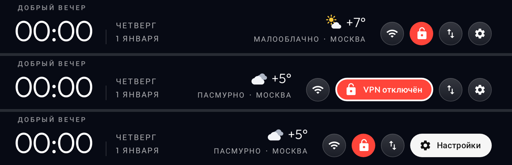

# CleanYourTV на Сбер Салют ТВ — с телефона, без компьютера

[CleanYourTV](https://github.com/Gathin23/cleanyourtv) убирает с Android-телевизора рекламу,
телеметрию и лишние приложения и ставит чистый домашний экран. Обычно его запускают с
компьютера. Здесь всё то же самое делается с **Android-телефона** через Termux.

Для Салют ТВ в CleanYourTV уже есть проверенный профиль:
[`examples/sber-salute-tv-at30a6`](https://github.com/Gathin23/cleanyourtv/tree/b06ab21105c49900cb1ed76b24414dba1e21d0db/examples/sber-salute-tv-at30a6)
(Салют ТВ 43", StarOS 1.101, Android 13, проверен 19–23 октября 2026). Скрипт `sber-tv.sh`
запускает **оригинальные скрипты проекта** с этим профилем. Домашний экран не собирается на
телефоне, а берётся уже собранный APK `tvhome-3.0-sber1.apk`: это лаунчер CleanYourTV из того же
коммита с тремя добавками для Салют ТВ — компактные кнопки сверху, включение и выключение VPN
кнопкой и погода (исходники правок — [`launcher/sber1.patch`](launcher/sber1.patch)). Скрипт
проверяет контрольную сумму APK.

> Пакеты только **отключаются** (`pm disable-user`), ничего не удаляется. Всё возвращается
> одной командой `restore`. Root и перепрошивка не нужны.

## Что понадобится

- Android-телефон в той же Wi-Fi-сети, что и телевизор. iPhone не подойдёт: на нём нет Termux.
- [Termux](https://f-droid.org/packages/com.termux/) из F-Droid или с
  [GitHub](https://github.com/termux/termux-app/releases). Версия из Google Play устарела и не работает.
- Около 150 МБ свободного места на телефоне.

Провода, флешка и компьютер не нужны: телефон управляет телевизором по Wi-Fi, а ярлык заводского
меню ставится на ТВ через интернет.

## Шаг 1. Включить ADB на телевизоре

Пункт «Для разработчиков» на Салют ТВ заблокирован: семь нажатий на номер сборки ничего не дают.
Есть два способа включить ADB, оба делаются с телефона и пульта.

**Вариант А: официальный, через SmartApp Studio.** Всё делается в браузере телефона.
1. Откройте [developers.sber.ru](https://developers.sber.ru) и войдите под **тем же Сбер ID**, что и на ТВ.
2. Создайте в личном пространстве пустой проект SmartApp. Без него раздел SmartApp не появится.
3. Откройте Настройки → Настройки сервисов → SmartApp → **Мои устройства**. Добавьте ТВ по
   серийному номеру (на ТВ: Настройки → Об устройстве; регистр важен) и включите **ADB**.
4. Перезагрузите телевизор.

На проверенном телевизоре переключатель включился, но порт 5555 так и остался закрытым.
Проверьте шагом 4 командой `probe`. Если подключиться не получится, используйте вариант Б.

**Вариант Б: заводское меню (FactoryMenu).**
1. Скачайте ярлык `FactoryMenu` (`com.stb.factorymenu` 1.2, 16 КБ) из
   [этого сообщения на 4PDA](https://4pda.to/forum/index.php?showtopic=1042253&view=findpost&p=114157954).
   Для скачивания нужен аккаунт на 4PDA.
2. Поставьте его на ТВ по интернету, через кабинет Сбера
   ([инструкция Сбера](https://sberdevices.ru/help/install-apps/)). Нужны прошивка 1.81 или новее
   и выключенный родительский контроль.
   - На телефоне откройте [apps.sber.ru/my](https://apps.sber.ru/my/) и войдите под тем же Сбер ID,
     что и на ТВ.
   - Нажмите «Прикрепите файл», выберите FactoryMenu из «Загрузок», нажмите «Сохранить» и
     дождитесь проверки на вирусы.
   - На ТВ откройте «Сервисы» → «Мои приложения» → «Загруженные» и нажмите на карточку FactoryMenu.

   Если кабинет не принял файл, остаётся флешка: скопируйте APK на неё через OTG-переходник,
   вставьте в ТВ и установите из файлового менеджера телевизора.
3. Откройте FactoryMenu, перейдите в **Debug** и включите **ADB Enable**.
4. **Больше в этом меню ничего не трогайте.** Там же лежат настройки панели и изображения.
   Другие приложения `com.cvte.*` тоже не открывайте.

## Шаг 2. Узнать IP телевизора

На ТВ: Настройки → Сеть → ваша сеть → IP-адрес, например `192.168.1.50`. Ещё его можно найти
в списке устройств на роутере.

## Шаг 3. Подготовить Termux

Откройте Termux и выполните:

```bash
pkg update && pkg upgrade -y
curl -LO https://raw.githubusercontent.com/dimavotinov73-beep/ShiftFlow/ccr-e16201a1-9rnk6y/sber-tv/sber-tv.sh
```

## Шаг 4. Проверить связь

```bash
bash sber-tv.sh 192.168.1.50 probe
```

При первом запуске скрипт скачает CleanYourTV (около 45 МБ), поставит Python и библиотеку для ADB.
Это займёт несколько минут.

На телевизоре появится вопрос **«Разрешить отладку по USB?»**. Отметьте «Всегда разрешать» и
нажмите OK. Слово «USB» тут ни на что не влияет: подключение идёт по Wi-Fi. После этого в Termux
появятся модель и версия Android телевизора.

## Шаг 5. Почистить телевизор

```bash
bash sber-tv.sh 192.168.1.50
```

Скрипт выполнит четыре шага, как в профиле CleanYourTV:

1. Отключит 25 приложений и сервисов Сбера (полный список с комментариями — в
   [`debloat.txt`](https://github.com/Gathin23/cleanyourtv/blob/b06ab21105c49900cb1ed76b24414dba1e21d0db/examples/sber-salute-tv-at30a6/debloat.txt)):
   Звук, «Видео», SberPlay, СберПрайм, «Детская комната», родительский контроль, «Умный дом»,
   браузер Салют, каталог приложений Сбера, заставку на 220 МБ, опросы, бета-программу, сборщик
   ошибок, приёмники трансляции экрана (Huawei Cast, MHshare, DLNA) и другие.
   Сообщение `Skipping ru.sberdevices.starlauncher: it owns Home` в этом шаге — это нормально:
   старый домашний экран отключит шаг 2.
2. Поставит новый домашний экран и сделает его главным, а старый домашний экран Сбера отключит.
   Если новый экран не запустится, старый останется на месте.
3. Применит настройки из профиля: служебные приложения скрыты, у приложений Сбера русские названия.
4. Включит заставку-часы нового экрана. Если оставить заставку Сбера, StarOS включит её обратно.

Если модель вашего ТВ отличается от проверенной (`at30a6`), скрипт предупредит и спросит,
продолжать ли.

### Что останется работать

- **Голосовой ассистент Салют.** Он встроен в системный сервис Сбера, который нельзя отключить.
- **HDMI- и AV-входы:** кнопка Inputs на новом экране переключает HDMI1–3 и AV.
- Клавиатура, WebView, настройки, пульт.
- **Обновления прошивки.** Они остаются включёнными, как в профиле по умолчанию.

## Google Play на телевизоре

**Настоящий Google Play на Салют ТВ без root не поставить.** В StarOS нет сервисов Google.
Play Маркету нужны «Сервисы Google Play» и Google Services Framework, и стоять они должны как
системные приложения (`/system/priv-app`). Для этого нужны root и отключённая проверка подписи
в прошивке. На 4PDA для телевизоров на этом шасси так и делают, но только с root. Сертификата
Google у такого ТВ всё равно не будет, и загрузки из Маркета, по отзывам, иногда зависают.
Без root через ADB этого не сделать, поэтому здесь такого способа нет.

**Что работает без root — Aurora Store.** Это открытый клиент Google Play: тот же каталог,
приложения скачиваются с серверов Google, можно войти анонимно, сервисы Google не нужны.
У версии 4.8.4 есть режим для Android TV: она видна в TV-лаунчере и не требует сенсорного экрана.

```bash
bash sber-tv.sh 192.168.1.50 aurora
```

Скрипт скачает Aurora Store с F-Droid и сверит контрольную сумму. Потом поставит Aurora на ТВ и
разрешит ей устанавливать приложения. Aurora появится на новом домашнем экране. При первом
запуске выберите **анонимный вход**.

Ограничения:

- Приложения, которым нужны сервисы Google, не запустятся или будут ругаться. Например,
  официальный YouTube для ТВ пишет, что устройство не поддерживается. Вместо него можно поставить
  [SmartTube](https://github.com/yuliskov/SmartTube/releases) командой `apk`, см. ниже.
- Покупки и подписки через Google Play не работают.
- Если установка приложения в Aurora зависает, поменяйте в настройках Aurora способ установки
  (Installer) на другой.
- Салют ТВ сам удаляет сторонние приложения, когда на диске остаётся меньше ~355 МБ. Если ставите
  много приложений, выполните один раз `bash sber-tv.sh 192.168.1.50 rotation` и перезагрузите ТВ.
- Чистка отключает каталог приложений Сбера. Скорее всего, через него же работает установка из
  кабинета apps.sber.ru/my, поэтому после чистки ставьте приложения через Aurora или командой `apk`.
  Если каталог нужен, включите его обратно:
  `bash sber-tv.sh 192.168.1.50 shell 'pm enable ru.sberdevices.starmarket'`.

### Поставить любой APK с телефона

```bash
termux-setup-storage     # один раз: даёт Termux доступ к «Загрузкам» телефона
bash sber-tv.sh 192.168.1.50 apk ~/storage/downloads/SmartTube.apk
```

Если приложение состоит из нескольких файлов (base.apk и split_*.apk), перечислите через
пробел все файлы одного приложения. Архивы `.apks`/`.xapk` сначала распакуйте:
`pkg install unzip && unzip файл.apks`.
Узнать, какая сборка нужна (armeabi-v7a или arm64-v8a):
`bash sber-tv.sh 192.168.1.50 shell 'getprop ro.product.cpu.abilist'`.

## Оформление: стиль, обои, цвет, погода, кнопка VPN



Сверху справа — погода и круглые кнопки: Wi-Fi, VPN (зелёная — включён, красная — выключен),
порядок приложений, настройки. Кнопка, на которой стоит выделение, раскрывается и показывает
подпись. OK на кнопке VPN включает или выключает VPN, удержание OK открывает само VPN-приложение.

```bash
bash sber-tv.sh 192.168.1.50 look
```

Если домашний экран на ТВ ещё старой версии, `look` сначала сам его обновит (оформление, обои и
порядок приложений сохранятся). Обновить отдельно: `bash sber-tv.sh 192.168.1.50 update-launcher`.

Скрипт задаст шесть вопросов, ответ — номер варианта (Enter выбирает первый):

| Вопрос | Варианты |
|---|---|
| Стиль | Классика · Стекло (матовая полоса, кнопки-иконки) · Кино (большая обложка выбранного приложения сверху) · Минимал (без полосы, тонкая рамка) · Плитки (иконки на цветных карточках) |
| Обои | Галерея из 35 картинок · рисованные пейзажи (14) · природа (12 фото) · Швеция (3 фото) · утро/день/ночь · северное сияние · тёмное стекло · осеннее озеро · **свои фото** · без обоев |
| Цвет фона | чёрный, ночной синий, графит, тёмно-зелёный, бордовый, фиолетовый или свой `#RRGGBB` |
| Подсветка выбранного | в цвет приложения или белая |
| Погода | название города (Enter — без погоды); скрипт сам найдёт его координаты |
| Кнопка VPN | одно из VPN-приложений на ТВ или без кнопки |

**Погода** берётся с [Open-Meteo](https://open-meteo.com): без ключей и регистрации, раз в полчаса,
только для указанного города. Для неё домашнему экрану нужен доступ в интернет — у исходного
CleanYourTV его нет; без погоды в теме экран в сеть не ходит.

**Кнопка VPN.** Android не даёт одному приложению переключать VPN другого, поэтому OK включает и
выключает VPN только там, где приложение само это разрешает:

| Приложение | Что делает OK |
|---|---|
| v2rayNG (и его форки, где сохранилась поддержка Tasker) | включает и выключает VPN с сервером, выбранным в приложении |
| WireGuard | включает и выключает туннель; скрипт спросит его имя, а в WireGuard нужно включить **Settings → Allow remote control apps** |
| Остальные (Happ, Hiddify, AmneziaVPN, v2RayTun…) | открывает приложение — включите VPN там |

Если команду приложение не выполнило (сервер не выбран, VPN ещё ни разу не включали вручную), через
несколько секунд кнопка сама откроет приложение. Первый раз VPN нужно включить в самом приложении,
чтобы Android спросил разрешение.

Свои фото скрипт берёт из файла или папки (по умолчанию `~/storage/downloads`, нужен один раз
`termux-setup-storage`), до 30 штук, и сам ужимает их до 1920×1080. Ответы можно передать сразу:
`bash sber-tv.sh 192.168.1.50 look 2 1 2 1` — Стекло, Галерея, ночной синий, подсветка в цвет приложения.

**На самом телевизоре** после этого:

- **переставить приложение:** удержите OK на плитке → «Переместить», стрелками перенесите, «Назад» —
  поставить. Или кнопка «Изменить порядок приложений» в верхней панели: OK — взять, стрелки —
  переместить, «Назад» — поставить, ещё раз «Назад» — готово;
- **убрать приложение с главного экрана или вернуть его:** удержите OK на плитке → «Убрать с главного
  экрана»; вернуть — в «Библиотеке приложений» в конце главного экрана;
- **выбрать конкретные обои, число плиток в ряду (4–7), непрозрачность полосы, анимации:** удержите OK
  на кнопке «Настройки» → «Настройки главного экрана». В «Обоях» есть все картинки выбранного набора;
  «Как в теме» возвращает смену раз в час.

Новая отправка `look` сбрасывает выбор, сделанный на ТВ. Вернуть оформление, которое ставит чистка:
`bash sber-tv.sh 192.168.1.50 look-reset`.

## Отменить всё

```bash
bash sber-tv.sh 192.168.1.50 restore
```

Команда вернёт пакеты в то состояние, в котором они были до чистки, вернёт домашний экран Сбера
и его заставку. Сведения о прежнем состоянии хранятся на телефоне в `~/.cleanyourtv/`.
Если IP телевизора с тех пор сменился, откат всё равно сработает, но включит все пакеты из списка.

## Когда закончите

```bash
bash sber-tv.sh 192.168.1.50 finish
```

После этого выключите на ТВ ADB: в FactoryMenu → Debug → ADB Enable = Off или в Studio. Затем
перезагрузите телевизор. Проверить, что порт закрыт:

```bash
bash sber-tv.sh 192.168.1.50 closed
```

## Если что-то пошло не так

| Что случилось | Что сделать |
|---|---|
| `Connection refused` / не подключается | ADB выключен или ТВ перезагружался: порт 5555 закрывается после перезагрузки. Включите ADB Enable в FactoryMenu ещё раз. Чтобы порт не закрывался, пока вы работаете: `bash sber-tv.sh IP keep-adb` |
| Сторонние приложения сами пропадают, а карточка остаётся | Это «ротация» Сбера: она удаляет приложения, когда на диске меньше ~355 МБ. Отключение места не освобождает. Понизить порог: `bash sber-tv.sh IP rotation`, затем перезагрузка |
| Хочу вернуть одно приложение | `bash sber-tv.sh IP shell 'pm enable ИМЯ.ПАКЕТА'` или на ТВ: Настройки → Приложения → приложение → Включить |
| Ещё что-то | Подробности по этой модели: [README профиля](https://github.com/Gathin23/cleanyourtv/blob/b06ab21105c49900cb1ed76b24414dba1e21d0db/examples/sber-salute-tv-at30a6/README.md) и [Troubleshooting](https://github.com/Gathin23/cleanyourtv/blob/b06ab21105c49900cb1ed76b24414dba1e21d0db/docs/TROUBLESHOOTING.md) |

## Риски

Всё это вы делаете на свой страх и риск. Заводское меню на платах CVTE опасно, если менять в нём
что-то кроме ADB Enable. Отключение пакетов обратимо, но гарантия производителя на такие
изменения может не распространяться.

---

Файлы в этой папке:

- `sber-tv.sh` — скрипт для Termux.
- `tvhome-3.0-sber1.apk` — домашний экран CleanYourTV 3.0 (`com.gathin.tvhome`, версия 3.0-sber1),
  собранный из коммита
  [`b06ab21`](https://github.com/Gathin23/cleanyourtv/tree/b06ab21105c49900cb1ed76b24414dba1e21d0db/launcher)
  с правками из `launcher/sber1.patch` (лицензия MIT, © Gathin). Контрольная сумма sha256:
  `d6e9d3e91c21f6a73f8dab3bf617656ba50117d81a80969b1fcb6566ba1d04e6`.
- `launcher/sber1.patch` — правки лаунчера: ключи темы `compact_pills`, `vpn_toggle`, `vpn_tunnel`,
  `weather_lat`, `weather_lon`, `weather_city`. Применяется к `b06ab21` командой `git apply`.
- `header.png` — как выглядит шапка (снимок с отрисовки лаунчера).
